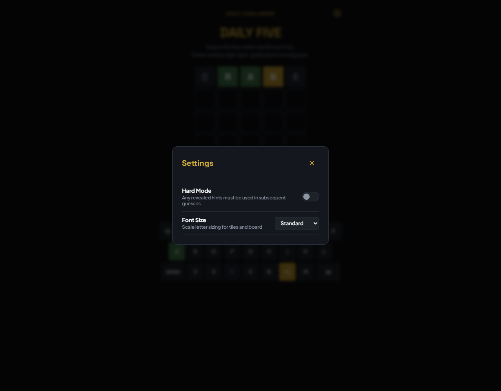

# Daily Five

A Wordle-style browser game: guess the five-letter word in six tries, tackle a new daily challenge, or keep playing with random words.

Built with **HTML, CSS, and vanilla JavaScript**. No account or installation required to play.


## Features

- **Daily challenge** — a shared word selected by the current UTC date.
- **Free Play** — finish a round and choose Play Again for a random word.
- **Letter feedback** — green for the right position, gold for the wrong position, and gray for absent letters, with repeated-letter scoring.
- **Hard Mode** — reuse revealed letters and keep confirmed green letters in place.
- **Keyboard support** — play with your physical keyboard or the on-screen keys.
- **Local statistics** — track games played, consecutive wins, and your best streak.
- **Personalization** — choose Standard, Large, or Extra Large letters.
- **Shareable results** — copy an emoji grid without revealing your guesses.

<details>
<summary>View settings</summary>



</details>

## Run locally

You need a modern browser, Git, and Python 3 to serve the files.

```bash
git clone https://github.com/SambhavPyakurel/Wordle.git
cd Wordle
```

Start a local server:

```powershell
# Windows
py -3 -m http.server 8000 --bind 127.0.0.1
```

```bash
# macOS / Linux
python3 -m http.server 8000 --bind 127.0.0.1
```

Open **[localhost:8000](http://localhost:8000)**. Press `Ctrl+C` in the terminal to stop the server. No npm install or build step is needed.

Use the local server instead of opening `index.html` directly: the game loads its dictionaries with `fetch()`. An internet connection is needed to retrieve the external valid-word list.

## How to play

1. Enter a five-letter word and press **Enter**. Use **Backspace** to remove a letter.
2. Follow the tile colors to narrow down the answer.
3. Solve the word within six guesses.
4. Copy your result or select **Play Again** to enter Free Play.

Enable Hard Mode before your first submitted guess. The settings button also controls letter size.

## Project structure

```text
Wordle/
├── index.html       # Game page and settings dialog
├── script.js        # Game state, scoring, dictionary loading, and storage
├── style.css        # Layout, colors, and animations
├── words.txt        # Answer list
└── docs/images/     # Screenshots
```

## Game data

Settings and statistics are stored in your browser's `localStorage`. They are not shared between browsers or devices. Streaks count consecutive wins across both modes, rather than consecutive calendar days.

Current guesses and daily completion are not saved: refreshing starts the daily round again. Hard Mode requires revealed letters but does not enforce repeated-letter counts. Clipboard sharing requires browser permission and HTTPS or localhost.

## Credits

Valid guesses are loaded from [tabatkins/wordle-list](https://github.com/tabatkins/wordle-list), with the local answer list added to the dictionary. Daily Five is an independent Wordle-style project and is not affiliated with the official Wordle game.
