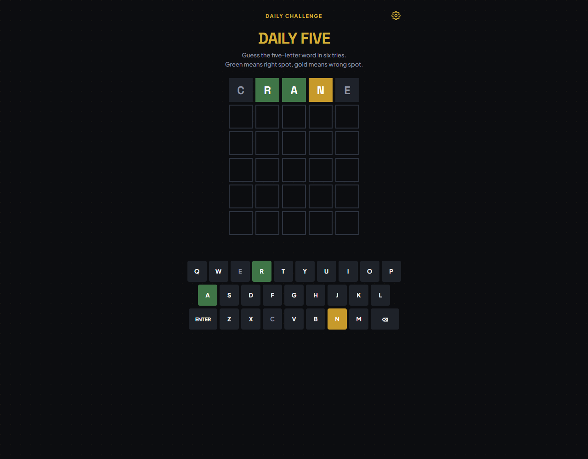

# Daily Five — Wordle-Style Game

A browser-based five-letter word game built with HTML, CSS, and vanilla JavaScript. Solve a daily challenge in six guesses, then continue with randomly selected words in Free Play.

## What it does

- Renders a six-row, five-column board with animated feedback: green for the correct position, gold for a letter elsewhere, and gray for absent letters.
- Uses a two-pass scoring algorithm that accounts for repeated letters.
- Supports physical and on-screen keyboards.
- Selects the daily answer using a UTC day index starting January 1, 2024.
- Starts random Free Play rounds through **Play Again** after a completed game.
- Offers Hard Mode: keep confirmed green positions and include previously revealed yellow letters.
- Saves games played, consecutive-win streak, best streak, Hard Mode, and font size in browser local storage.
- Generates an emoji result grid that can be copied to the clipboard.

## Screenshots

Actual screenshots of the current project running locally.



<details>
<summary>Settings: Hard Mode and font size</summary>


</details>

## How to run

You need Git, a modern browser, and Python 3 for a local web server. There are no npm dependencies, build steps, accounts, or API keys.

```bash
git clone https://github.com/SambhavPyakurel/Wordle.git
cd Wordle
```

**Windows PowerShell:**

```powershell
py -3 -m http.server 8000 --bind 127.0.0.1
```

**macOS / Linux:**

```bash
python3 -m http.server 8000 --bind 127.0.0.1
```

Open [http://localhost:8000](http://localhost:8000). Keep the terminal running; press **Ctrl+C** to stop. If port 8000 is busy, use 8001 in both the command and URL.

Use HTTP rather than double-clicking `index.html`: the game uses `fetch()` to load word lists. Internet access is required at startup for its external dictionary.

## How to play

1. Type a five-letter word and press **Enter**. Use **Backspace** to delete a letter.
2. Use the tile and keyboard colors to refine your next guess.
3. Enable Hard Mode before submitting the first guess of a round, if desired.
4. After finishing, view statistics, copy the result, or choose **Play Again**.

Font sizes are Standard, Large, and Extra Large. Statistics belong to the browser and origin; changing ports or clearing site data gives you a separate or empty history.

## Project structure

| File | Purpose |
| --- | --- |
| `index.html` | Board containers, results, and settings dialog |
| `script.js` | Dictionary loading, daily selection, input, scoring, and persistence |
| `style.css` | Layout, colors, animations, and font scaling |
| `words.txt` | Local answer list; 508 five-letter entries at review time |
| `DAILYFIVE.png` | Existing repository image asset |
| `docs/images/` | README screenshots |

Valid guesses also come from [tabatkins/wordle-list](https://github.com/tabatkins/wordle-list), fetched from raw GitHub at startup. Local answers are added to the accepted-guess set. This is an independent Wordle-style project, not an official Wordle product.

## Verification and limitations

Verified locally in headless Microsoft Edge: dictionary loading, a submitted guess, settings rendering, and duplicate-letter scoring. The loaded dictionary contained 14,855 unique entries during the check; the external list can change. This was a smoke check, not a comprehensive browser or accessibility test.

- Reloading starts a new daily round. Current guesses and daily completion are not persisted, so the same daily word can be replayed and counted again.
- Streaks count consecutive wins across daily and Free Play rounds, not consecutive calendar days.
- Hard Mode stores yellow letters as a set, so it does not enforce repeated-letter counts or every positional restriction.
- No offline dictionary fallback, backend, account sync, or automated test suite is included.
- Clipboard copying depends on browser permissions and a secure context such as HTTPS or localhost; failures are not handled in the UI.
- Malformed local-storage values can interrupt startup. Clear this site's storage if loading repeatedly fails.
